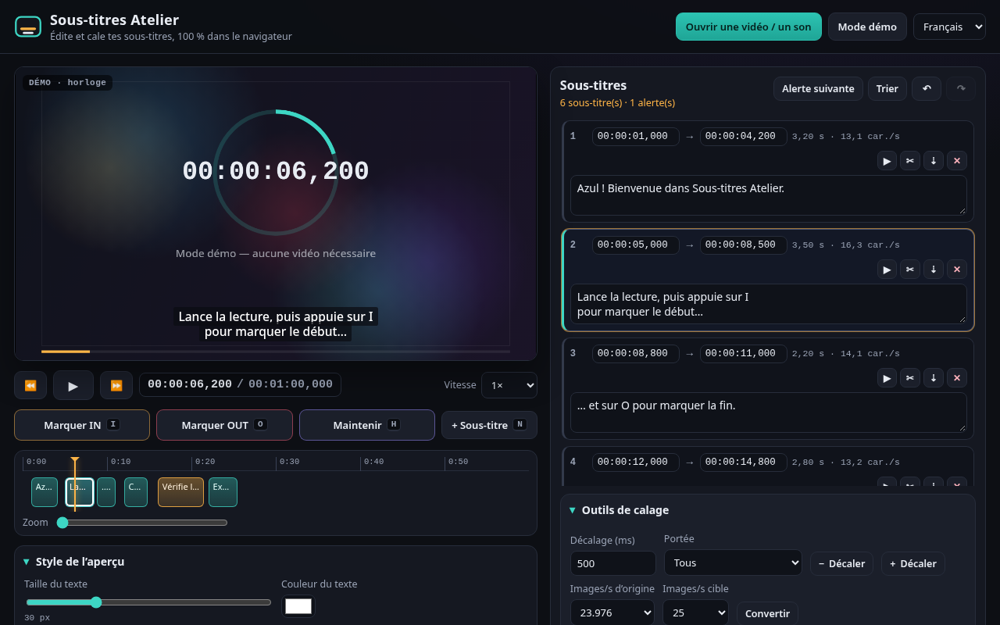
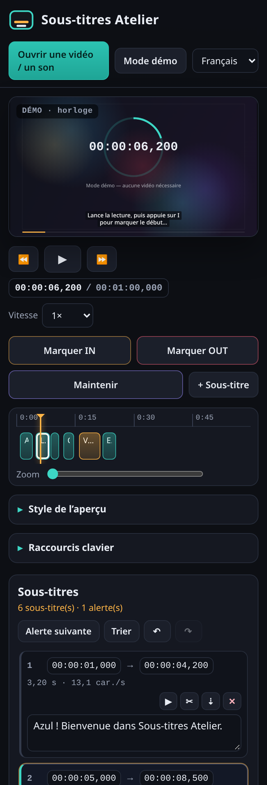

# Sous-titres Atelier

**FR** — Éditeur et outil de calage de sous-titres gratuit pour vidéastes, 100 % dans le navigateur. Ouvre une vidéo ou un son local, marque les entrées / sorties au clavier pendant la lecture, vois les sous-titres en direct sur l’image, corrige le timing (décalage, conversion d’images/s), surveille la vitesse de lecture et exporte en SRT, WebVTT, TXT ou JSON. Aucun fichier n’est envoyé à un serveur.

**EN** — Free subtitle editor and timing tool for video makers, fully in the browser. Open a local video or audio file, mark IN / OUT with the keyboard while it plays, preview the subtitles live on the picture, fix the timing (shift, framerate conversion), watch the reading speed and export SRT, WebVTT, TXT or JSON. Nothing is uploaded.

**Taqbaylit** — Amaẓrag n yiduzwilen baṭel i yimeskaren n tvidyutin, akk deg yiminig. Ldi avidyu neɣ ameslaw seg yibenk-ik, creḍ IN / OUT s unasiw, wali iduzwilen srid ɣef tugna, seɣti akud, sifeḍ s SRT, WebVTT, TXT neɣ JSON. Ulac afaylu ara yettwaznen.

👉 **Démo / Demo : https://salimadour31-boop.github.io/soustitres-atelier/**



## Fonctionnalités

- **Lecteur local** : vidéo ou audio ouvert depuis ton disque (URL objet `blob:`, rien n’est uploadé), vitesse 0,5× à 2×.
- **Mode démo sans vidéo** : une horloge animée sert de média, pour tester le calage tout de suite.
- **Création au clavier pendant la lecture** :
  - <kbd>I</kbd> / <kbd>O</kbd> pour marquer début et fin ;
  - <kbd>H</kbd> **en mode maintien** : IN à l’appui, OUT au relâchement (ou bascule IN/OUT si tu préfères) ;
  - bouton « Maintenir » utilisable au doigt sur mobile ;
  - option **Enchaîner** : chaque OUT ouvre directement le sous-titre suivant.
- **Texte à caler** : colle ton script, chaque nouveau sous-titre prend la ligne suivante (`|` = retour à la ligne).
- **Liste éditable** : texte multi-ligne, début / fin modifiables (formats `00:01:02,500`, `1:02.5`, `62.5`…), ajouter, couper (à la tête de lecture ou au milieu), fusionner avec le suivant, supprimer, trier.
- **Annuler / rétablir** (<kbd>Ctrl</kbd>+<kbd>Z</kbd> / <kbd>Ctrl</kbd>+<kbd>Y</kbd>).
- **Aperçu en surimpression** : taille, couleur, boîte de fond (couleur + opacité), contour, gras, position haut / bas. Les balises `<i>`, `<b>`, `<u>` sont affichées.
- **Frise** des sous-titres avec règle, zoom, tête de lecture : clic ou glisser pour se déplacer, clic sur un bloc pour le sélectionner.
- **Outils de calage** : décalage global ± ms (tous, à partir du sélectionné, ou sélectionné seul), conversion d’images/s (23,976 ↔ 24 ↔ 25 ↔ 29,97 ↔ 30 ↔ 50 ↔ 59,94 ↔ 60), étirement par facteur, correction automatique des chevauchements.
- **Contrôles qualité** : chevauchement, fin ≤ début, vitesse de lecture (caractères / seconde, 17 par défaut), longueur de ligne (42 par défaut), plus de 2 lignes, durée trop courte, sous-titre vide ; bouton « Alerte suivante ».
- **Import** SRT, WebVTT et JSON (fichier ou copier-coller ; ajout à la suite possible). Les vieux SRT en Windows-1252 sont relus correctement.
- **Export** SRT, WebVTT, transcription TXT et JSON (UTF-8).
- **Sauvegarde automatique** du projet dans `localStorage` (le média lui-même n’est jamais stocké).
- Interface **français / English / Taqbaylit**, langue mémorisée.
- Responsive (bureau ~1280 px, mobile ~375 px), thème sombre original, polices système, aucune dépendance, fonctionne aussi en ouvrant `index.html` directement (`file://`).

## Utilisation

1. Ouvre la [démo](https://salimadour31-boop.github.io/soustitres-atelier/) (ou `index.html` en local, sans serveur).
2. Clique sur **Ouvrir une vidéo / un son**, ou reste en **Mode démo**.
3. Lance la lecture (<kbd>Espace</kbd>) et marque chaque sous-titre avec <kbd>I</kbd> puis <kbd>O</kbd> (ou maintiens <kbd>H</kbd>).
4. Tape les textes dans la liste (ou prépare-les dans **Texte à caler**), ajuste les temps, corrige les alertes.
5. Si besoin, décale ou convertis les images/s, puis exporte en **SRT** ou **WebVTT**.

| Raccourci | Action |
|---|---|
| <kbd>Espace</kbd> | lecture / pause |
| <kbd>I</kbd> / <kbd>O</kbd> | marquer IN / OUT |
| <kbd>H</kbd> (maintenir) | IN à l’appui, OUT au relâchement |
| <kbd>N</kbd> | nouveau sous-titre à la tête de lecture |
| <kbd>←</kbd> <kbd>→</kbd> | ±1 s (<kbd>Maj</kbd> : ±0,1 s) |
| <kbd>↑</kbd> <kbd>↓</kbd> | sous-titre précédent / suivant |
| <kbd>[</kbd> <kbd>]</kbd> | caler le début / la fin du sous-titre choisi sur la tête de lecture |
| <kbd>S</kbd> / <kbd>M</kbd> / <kbd>Suppr</kbd> | couper / fusionner / supprimer |
| <kbd>Ctrl</kbd>+<kbd>Z</kbd> / <kbd>Ctrl</kbd>+<kbd>Y</kbd> | annuler / rétablir |
| <kbd>Échap</kbd> | quitter un champ de texte (ou annuler un IN en attente) |

Les formats de navigateur courants (MP4/H.264, WebM, MP3, WAV, OGG…) sont lisibles ; un MKV peut ne pas l’être selon le navigateur.



## Structure

| Fichier | Rôle |
|---|---|
| `index.html` | Page et structure de l’interface |
| `styles.css` | Thème sombre et mise en page responsive |
| `subs.js` | Cœur sans DOM : horodatages, import/export SRT · WebVTT · TXT · JSON, décalage, images/s, contrôles |
| `i18n.js` | Traductions FR / EN / Taqbaylit |
| `app.js` | Lecteur, mode démo, marquage IN/OUT, liste, frise, aperçu, outils, sauvegarde |
| `tests/unit.js` | Tests unitaires Node du parseur et du formatage |
| `tests/e2e.js` | Tests Playwright (bureau 1280×800 et mobile 375×812, depuis `file://`) |

## Tests

```bash
node tests/unit.js                      # aucun module requis
npm i playwright && npx playwright install chromium   # à faire hors du dépôt si tu préfères
node tests/e2e.js                       # SHOTS=1 pour régénérer les captures
```

Les tests de bout en bout vérifient : absence d’erreurs console, les 3 langues et leur mémorisation, création de sous-titres en mode démo (I/O, maintien H, boutons), édition, annuler/rétablir, couper/fusionner/supprimer, aller-retour SRT import → export, export WebVTT / TXT / JSON, import de fichier VTT, décalage, conversion d’images/s, alertes, frise, sauvegarde et, si `ffmpeg` est présent, une vraie vidéo locale.

## Contribuer

Les corrections (surtout les traductions en taqbaylit, qui sont un premier jet) sont les bienvenues via issue ou pull request.

## Licence

[MIT](LICENSE). Code original ; aucune ressource tierce, aucune bibliothèque externe. Polices système uniquement.
